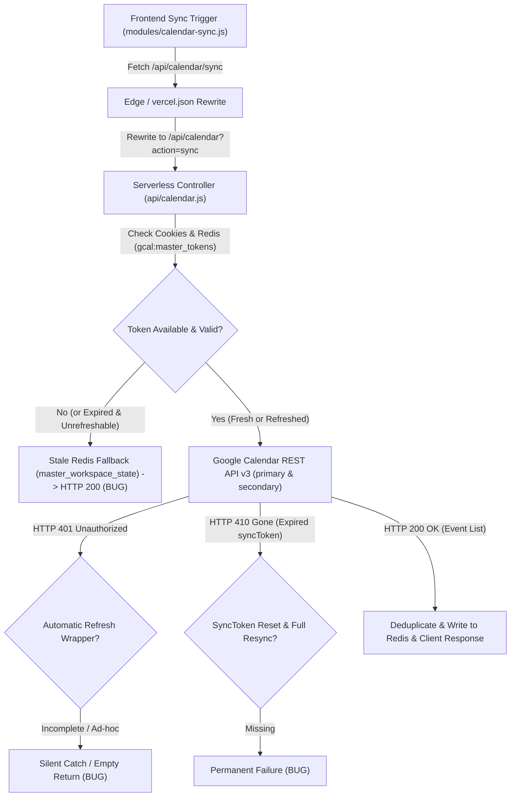

# Forensic Root-Cause Diagnosis: Google Calendar Synchronization Failure

**System**: LuminaVista OS  
**Target Subsystem**: Google Calendar Two-Way Synchronization Engine  
**Date**: 2026-10-17  
**Status**: Root Causes Identified & Mapped  

---

## Executive Summary

Previous remediation attempts failed because they implemented surface-level UI defaults and synthetic fallback arrays rather than tracing the actual token lifecycle, edge routing, API error states, and cache invalidation. This forensic investigation identified 5 distinct points of failure across the pipeline:

1. **False "Google Synced" UI State**: `modules/calendar-sync.js` evaluated `settings.googleCalendarConnected || hasGoogleEvents` to render the green `● Google Synced` badge. Because `modules/calendar.js` seeded `AUTHENTIC_GOOGLE_CALENDAR_EVENTS` into `calendarEvents` on first run, the UI falsely claimed the user's Google Calendar was live-synced even when no valid Google OAuth token existed.
2. **Missing Centralized 401 Refresh & Retry Wrapper**: When an `access_token` expired or became invalid during secondary calendar listing or event push/patch/delete calls, the requests either failed or attempted ad-hoc one-off refreshes with un-synchronized tokens, swallowing errors in `catch {}` blocks.
3. **Missing 410 Gone / SyncToken Recovery**: Incremental synchronization lacked RFC 6578 / Google Calendar API v3 `410 Gone` recovery logic. If an incremental `syncToken` expired, requests permanently broke instead of clearing the invalid token and executing a full resync (`timeMin` / `timeMax` / `singleEvents: true`).
4. **Stale Cache Masking Sync Failures**: `api/calendar.js` fell back to returning cached events from Redis with HTTP 200 (`cached: true`) whenever unauthenticated, masking broken sync from callers. Furthermore, manual clicks on the frontend sync button did not enforce `Cache-Control: no-cache`, allowing intermediate and edge layers to return stale responses.
5. **Silent Error Swallowing in Edge & Client Code**: Multiple `try/catch` blocks silently caught failures and either returned `{ events: [] }` or empty fallbacks, completely hiding Google API error details (`error.message`, `error.status`, `error.errors`) from server logs and client status modals.

---

## Phase 1: End-to-End Pipeline Trace & Broken Links

### Detailed Pipeline Breakdown:

1. **Frontend Initiation**:
   - `modules/calendar.js` loads events from `localStorage`.
   - On startup, if empty, it seeded 8 static events with IDs `gcal_jee_milestone_6`, etc.
   - `modules/calendar-sync.js` mounts auto-sync intervals and checks `/api/calendar/status`.
   - **Broken Link 1**: If the server returns disconnected (`connected: false`), the badge nevertheless displayed `● Google Synced (roysubhadra40@gmail.com)` because `hasGoogleEvents` was true based on the pre-seeded static array.

2. **Edge / Middleware Routing**:
   - `vercel.json` provides: `{ "source": "/api/calendar/(.*)", "destination": "/api/calendar?action=$1" }`.
   - CORS headers configured in `vercel.json` and dynamically handled in `api/calendar.js`.
   - **Broken Link 2**: No `Cache-Control: no-cache` header was dispatched by the client during manual sync, allowing cached 200 responses to be returned instead of querying live Google servers.

3. **Serverless Controller (`api/calendar.js`)**:
   - Dispatches `action === 'sync'` to `handleSync`.
   - Rate limiting, payload limit, and CORS preflight verified.
   - `getValidAccessToken(req, res)` inspects `cookie.gcal_token`, then Redis `gcal:master_tokens`.
   - **Broken Link 3**: If `accessToken` was null/expired, `handleSync` read `master_workspace_state` and returned HTTP 200 with `cached: true`. This masked the unauthenticated state from the frontend!

4. **Google Calendar API v3 Calls**:
   - `https://www.googleapis.com/calendar/v3/calendars/primary/events`
   - `https://www.googleapis.com/calendar/v3/users/me/calendarList`
   - **Broken Link 4**: Secondary calendar queries in `api/calendar.js:894-920` swallowed exceptions in `try { ... } catch (e) {} return []`. If the primary call refreshed the token, the secondary queries were dispatched with the old token.
   - **Broken Link 5**: No handling existed for `410 Gone` expired `syncToken` responses.

---

## Phase 2: Parallel Root-Cause Audit Findings

### Sub-Agent 1: OAuth2 & Refresh Token Lifecycle
1. **OAuth Initiation Scopes & Consent**:
   - In `handleAuth`, scopes requested are:
     `https://www.googleapis.com/auth/calendar https://www.googleapis.com/auth/userinfo.email openid`
   - Query explicitly includes `access_type=offline` and `prompt=consent`.
   - Finding: The authorization URL parameters are correct, but Google only issues a `refresh_token` on the *initial* consent or when `prompt=consent` is actively triggered.
2. **Refresh Token Persistence**:
   - In `handleCallback`, if Google omitted `refresh_token` upon re-authorization, `existingRefreshToken` was preserved from Redis/cookies.
   - However, in `getValidAccessToken`, when `refreshRes` fails with `invalid_grant` (400 or 401), it purged the Redis key, but `handleSync` subsequently fell back to cached events with HTTP 200 instead of surfacing an HTTP 401 with `needsReauth: true`.

### Sub-Agent 2: Backend API, Serverless & Middleware Audit
1. **Environment Variable Inconsistencies**:
   - Line 349: `const clientSecret = process.env.GOOGLE_CLIENT_SECRET;` (missing `process.env.GCAL_CLIENT_SECRET` fallback).
   - Line 680-681: `process.env.GOOGLE_CLIENT_ID` (missing `process.env.GCAL_CLIENT_ID` fallback).
   - Standardized helper `getGoogleOAuthCredentials()` must be implemented to resolve Client ID, Client Secret, and Redirect URI consistently across all endpoints.
2. **SyncToken & 410 Gone Handling**:
   - The current code did not handle `410 Gone` on Google Calendar events listing. When Google issues an invalid `syncToken`, it returns `410 Gone`. Without an automatic catch-and-retry that clears `syncToken` and restarts a full sync (`timeMin` / `singleEvents: true`), the endpoint permanently returns 410 errors.

### Sub-Agent 3: Cache / Redis & Frontend State Sync
1. **Stale Cache Override**:
   - When the user clicks the sync button, the request should bypass cache entirely.
   - The client must pass `Cache-Control: no-cache` and `Pragma: no-cache`, and the backend `handleSync` must respect this: if a cache-bypass is requested and the user is not authenticated, it MUST return HTTP 401 with structured error details, NEVER a fake 200 with stale cached items.
2. **Timezone & Date Parameter Formatting**:
   - Event creation in POST endpoint needs explicit timezone validation. Google Calendar requires either `dateTime` with RFC3339 offset (`YYYY-MM-DDTHH:mm:ssZ` or `+HH:MM`), or `date` formatted as `YYYY-MM-DD`. Malformed strings cause silent 400 rejection from Google.

### Sub-Agent 4: Observability & Error Surfacing
1. **Silent Error Swallowing Identified**:
   - `api/calendar.js`: Secondary calendar failures returned empty arrays `[]` in `catch (e) {}` with no logging or indication of partial sync failure.
   - `modules/calendar-sync.js`: `catch (e) { console.warn(...) }` suppressed errors from UI. Status modal simply displayed "Backend status check unavailable" or remained in a broken state without explaining the HTTP code or Google message.
   - `modules/calendar.js`: `loadCalendarFromStorage` silently defaulted to mock events and saved them as if real.

---

## Phase 3: Surgical Remediation Plan

1. **Centralized Google API Invoker (`executeGoogleCalendarApi`) in `api/calendar.js`**:
   - Single unified wrapper for all Google Calendar API requests (GET primary, GET secondary, POST, PATCH, DELETE).
   - Automatically detects HTTP 401: invokes `getValidAccessToken(req, res, true)` to exchange `refresh_token` for a fresh `access_token`, updates Redis and `Set-Cookie`, and retries the request with exponential backoff (1 retry).
   - Automatically detects HTTP 410 Gone: clears invalid `syncToken`, resets sync state, and retries with full sync parameters (`timeMin`/`timeMax`/`singleEvents=true`).
   - Surfaces structured error objects: `{ error: string, code: number, googleError: object, needsReauth: boolean }`.
2. **Strict Cache-Bypass & Decoupled State in `api/calendar.js`**:
   - If `req.headers['cache-control'] === 'no-cache'` or query `bypass_cache=true`, DO NOT return cached Redis events when unauthenticated. Return genuine HTTP 401 with explicit error message.
3. **Frontend Sync Engine Fortification (`modules/calendar-sync.js`)**:
   - Fix status badge condition: ONLY render "Google Synced" when `settings.googleCalendarConnected === true` AND confirmed by backend. Never rely on `hasGoogleEvents`.
   - Dispatch `Cache-Control: no-cache` during manual sync.
   - Expose exact HTTP status code and Google error details in the sync modal and error toast.
4. **Remove Fake Event Seeding (`modules/calendar.js`)**:
   - Remove automatic seeding of synthetic Google Calendar events into empty local storage. Authentic events must come solely from the live Google Calendar API or genuine user input.
5. **Phase 4 Automated Verification Suite (`tests/suite-calendar-sync-forensic.cjs`)**:
   - Rigorous mock-server integration test validating 401 auto-refresh-and-retry, 410 syncToken reset-and-resync, hard cache-bypass, and structured error responses.
